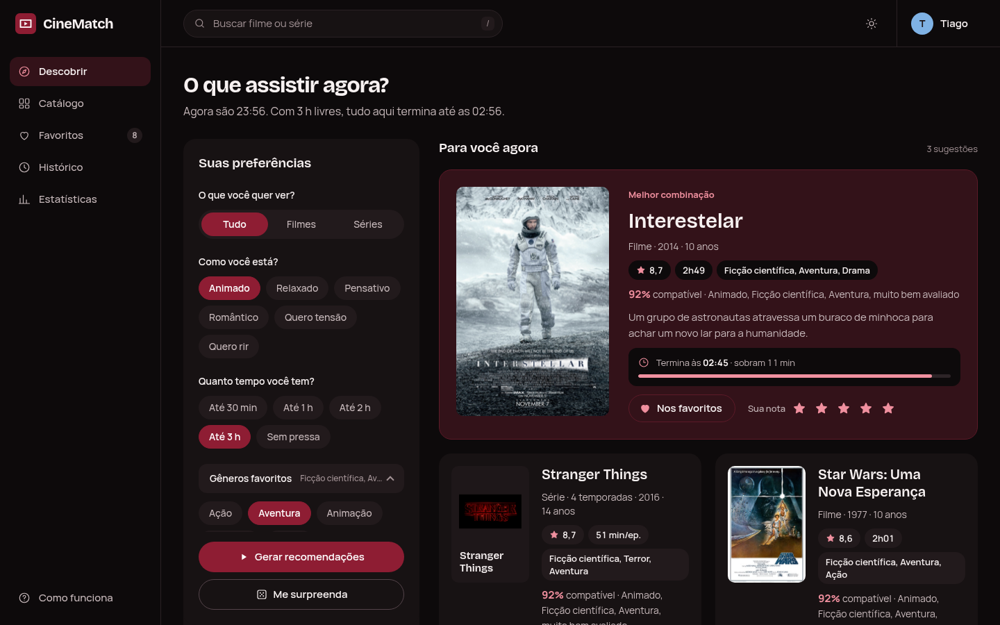
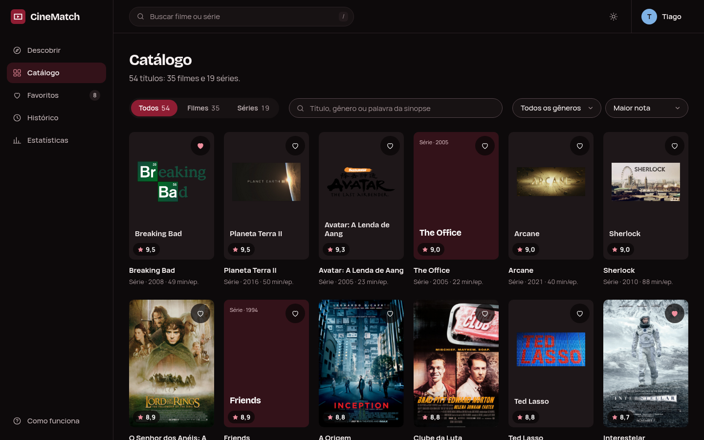
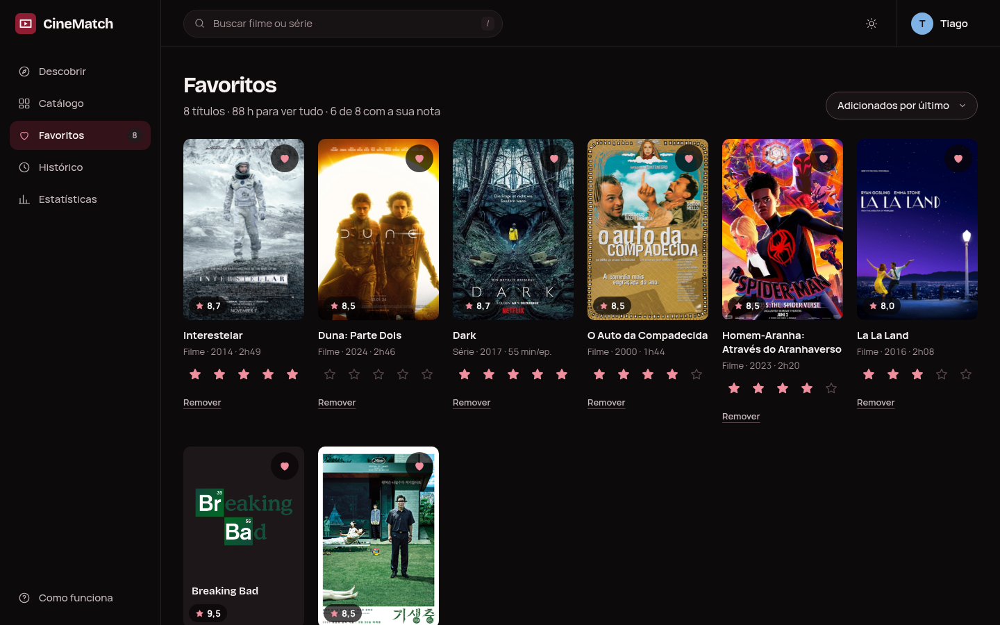
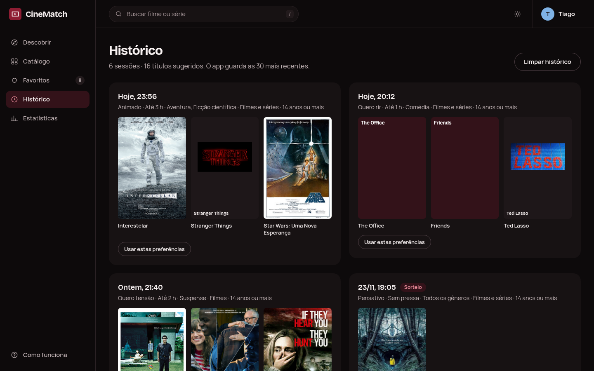
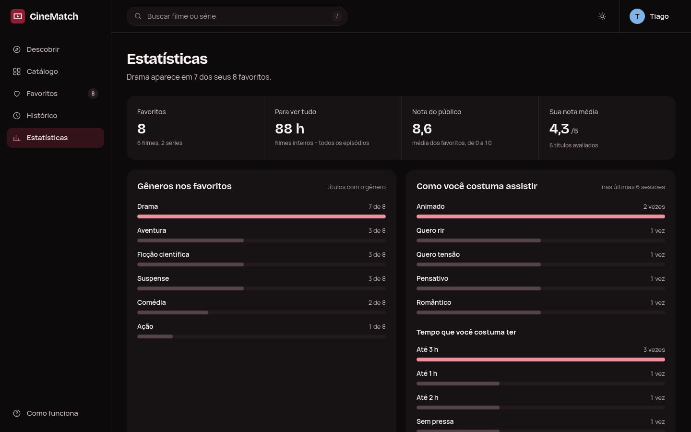
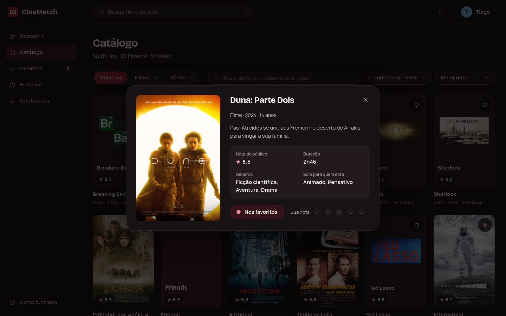
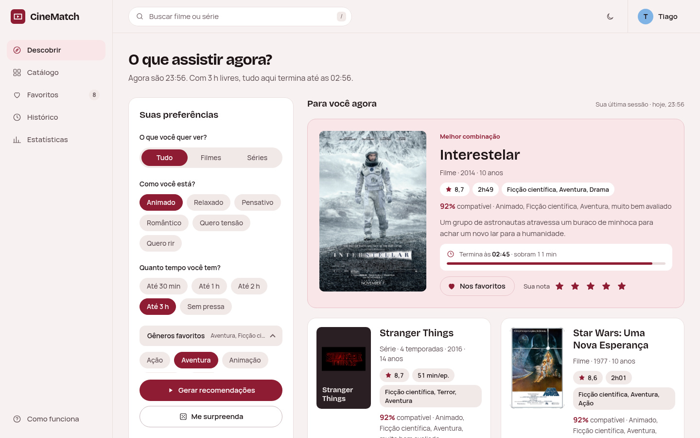
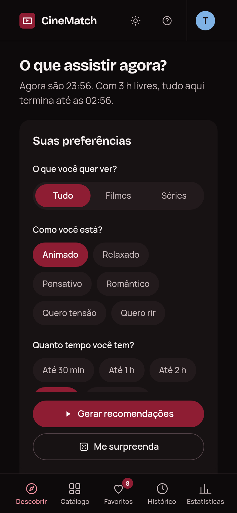
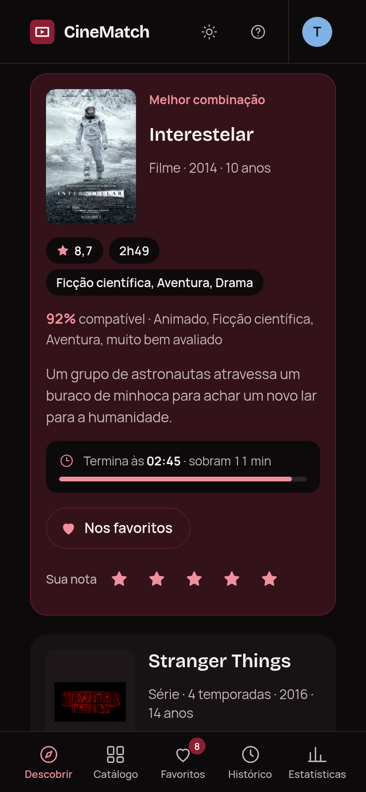
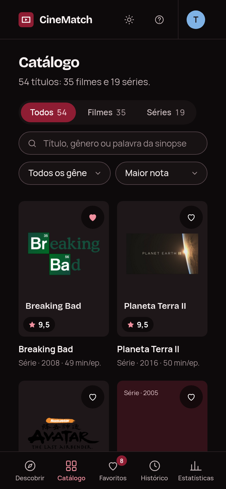

# Relatório do Projeto: CineMatch

**Disciplina:** Desenvolvimento de Interfaces (HTML, CSS e JavaScript)
**Projeto:** CineMatch, recomendador de filmes e séries (Vibe Coding)
**Autor:** Tiago Carvalho (trabalho individual)
**Data:** 25/11/2026

**Aplicação publicada:** [https://tiagocarvalho08.github.io/cinematch/](https://tiagocarvalho08.github.io/cinematch/)

**Código-fonte:** [https://github.com/tiagocarvalho08/cinematch](https://github.com/tiagocarvalho08/cinematch)


---

## 1. Introdução

Escolher o que assistir virou uma tarefa demorada: os catálogos são enormes e muita gente passa mais tempo rolando a lista do que assistindo. O CineMatch é uma aplicação web que reduz essa indecisão. A pessoa diz como está se sentindo, quanto tempo tem e de quais gêneros gosta, e recebe três sugestões explicadas em poucos segundos.

O projeto foi desenvolvido com **HTML5, CSS3 e JavaScript puro**, com **LocalStorage** para guardar os dados no navegador, seguindo a proposta de **Vibe Coding**: programar em parceria com uma ferramenta de IA, com o autor definindo os requisitos, tomando as decisões de produto e revisando e testando o que foi gerado.

## 2. Problema e objetivo

**Problema:** excesso de opções e falta de critério rápido para decidir o que assistir em um momento específico (por exemplo: "tenho 1 hora, estou cansado, quero rir").

**Objetivo geral:** criar uma aplicação web que sugira filmes e séries com base nas preferências do usuário, utilizando Vibe Coding.

**Objetivos específicos:**

- Coletar preferências por meio de um formulário simples (gênero, faixa etária, tempo e humor).
- Gerar recomendações compatíveis e explicar por que cada uma foi escolhida.
- Permitir salvar favoritos, avaliar títulos e consultar o histórico.
- Oferecer tema claro e escuro e funcionar bem no celular, no tablet e no computador.
- Aplicar as 10 Heurísticas de Nielsen na interface.

## 3. Metodologia: Vibe Coding

O desenvolvimento seguiu um fluxo de IA com "skills" de design, na ordem recomendada pelo material de apoio (`COLA-SKILLS.md`):

| Etapa | Ferramenta / skill | O que foi feito |
|---|---|---|
| 1. Referência visual | `design-md-library` | Comparação de 3 estilos (Spotify, Ferrari e Wired). A primeira escolha foi **Ferrari: cinema editorial**: fundo quase preto, tipografia branca contida e um único vermelho de "cortina de cinema". |
| 2. Construção | `design-taste-frontend` | Definiu a aplicação como **tela de uso** (app) e sorteou o estilo *true-black flat*: elevação só por tons de cinza e cor apenas nos dados. Gerou a estrutura, o catálogo e as telas. |
| 3. 3D | `img2threejs` | Não utilizado: o projeto não tinha um objeto real para modelar. |
| 4. Revisão | `impeccable audit`, `polish` e `adapt` | Auditoria de acessibilidade, desempenho, temas e responsividade, seguida das correções. |
| 5. Nova rodada | revisão do autor + audits | Paleta escura com bordô, pôsteres reais, catálogo em grade e nova passagem pelos dois verificadores até zerar as falhas. |

**Papel do autor:** definir os requisitos a partir do enunciado; responder às perguntas de direção feitas pela IA (fonte de dados, estilo visual, diferenciais, publicação); reprovar a primeira versão visual e pedir a paleta escura com bordô e pôsteres reais; testar cada funcionalidade; publicar no GitHub; e revisar este relatório.

**Exemplos de comandos usados com a IA:**

- "Usa a design-md-library e me sugere 3 estilos para um recomendador de filmes."
- "Usa a design-taste-frontend e cria o CineMatch com a estrutura index.html, css/style.css, js/app.js, js/movies.js e js/storage.js."
- "/impeccable audit index.html", depois "/impeccable polish" e "/impeccable adapt".

## 4. Requisitos

### 4.1 Requisitos funcionais

| Código | Requisito | Como foi atendido |
|---|---|---|
| RF01 | Selecionar preferências | Formulário com tipo, humor (6 opções), tempo (5 faixas), 13 gêneros e faixa etária (Livre a 18 anos). As escolhas ficam salvas a cada mudança. |
| RF02 | Gerar recomendações | Três sugestões com nota, duração, categoria, % de compatibilidade e o motivo ("Combina por: Animado · Ficção científica"). |
| RF03 | Adicionar favoritos | Botão de coração nos cartões, no catálogo e na janela de detalhes. |
| RF04 | Remover favoritos | Na tela Favoritos (com opção *Desfazer*) ou desmarcando o coração em qualquer tela. |
| RF05 | Visualizar histórico | Lista das últimas 30 sessões com data, preferências usadas e títulos sugeridos. |
| RF06 | Salvar dados localmente | Módulo `storage.js` grava tudo no LocalStorage, separado por perfil. |

### 4.2 Requisitos não funcionais

- **Responsividade:** layouts próprios para computador (≥ 1180 px), notebook/tablet e celular (≤ 640 px).
- **Acessibilidade:** HTML semântico, foco visível, navegação por teclado, contraste mínimo de 4,5:1 nos dois temas e respeito ao "reduzir movimento".
- **Desempenho:** sem bibliotecas externas, sem etapa de build; os pôsteres carregam sob demanda (`loading="lazy"`) e têm proporção fixa, para a página não pular enquanto carregam.
- **Hospedagem:** arquivos estáticos publicados no GitHub Pages.

## 5. Arquitetura e organização do código

```
cinematch/
├── index.html      estrutura de todas as telas (seções) e diálogos
├── css/style.css   tokens de cor dos temas, layout, componentes e responsivo
├── js/movies.js    dados: catálogo de 54 títulos e listas do formulário
├── js/storage.js   camada de persistência (LocalStorage)
├── js/app.js       lógica de interface dividida em 15 seções comentadas
└── assets/images/  logo e favicon em SVG
```

- **Separação de responsabilidades:** dados (`movies.js`), persistência (`storage.js`) e interface (`app.js`). A interface nunca acessa o LocalStorage diretamente.
- **Uma página, várias telas:** a navegação usa o `#` da URL (`#descobrir`, `#catalogo`, `#favoritos`, `#historico`, `#estatisticas`). Assim o botão "voltar" do navegador funciona e cada tela pode ser aberta por link.
- **Eventos delegados:** um único ouvinte de clique no documento trata os botões que são recriados a cada atualização (favoritar, estrelas, detalhes).
- **Conferência dos dados:** `movies.js` verifica no console se há ids repetidos ou gêneros inválidos.

### 5.1 Uso do LocalStorage

| Chave | Conteúdo |
|---|---|
| `cinematch:tema` | `"claro"` ou `"escuro"` |
| `cinematch:perfis` | lista de perfis `{ id, nome, cor }` |
| `cinematch:perfilAtivo` | id do perfil em uso |
| `cinematch:<perfil>:preferencias` | último formulário preenchido |
| `cinematch:<perfil>:favoritos` | `[{ id, adicionadoEm }]` |
| `cinematch:<perfil>:avaliacoes` | `{ idDoTitulo: 1..5 }` |
| `cinematch:<perfil>:historico` | `[{ quando, preferencias, titulos, modo }]` (máx. 30) |

Todas as leituras usam `try/catch`. Se o navegador bloquear o armazenamento (aba anônima, por exemplo), o app continua funcionando em memória.

### 5.2 Algoritmo de recomendação

1. **Filtro:** remove títulos de outro tipo, com classificação acima da faixa etária ou mais longos que o tempo disponível. Nas séries, vale a duração de um episódio.
2. **Pontuação (0 a 1):** `0,4 × gêneros + 0,3 × humor + 0,3 × nota`.
   - Gêneros: 0 se não há gênero em comum; de 0,5 a 1 conforme a proporção em comum; 0,5 se o usuário não escolheu gênero.
   - Humor: 1 se combina, 0 se não combina, 0,5 se não foi escolhido.
   - Nota: `(nota − 5) / 5`, limitada entre 0 e 1.
3. **Variedade:** títulos sugeridos nas duas últimas sessões perdem 0,15 na ordenação.
4. **Me surpreenda:** sorteia entre os títulos com pelo menos 50% de compatibilidade.

Quando os filtros deixam menos de três títulos, o app explica o motivo e oferece atalhos ("Incluir séries", "Dar mais tempo").

## 6. Interface















<div class="figuras-celular" markdown="1">







</div>

**Identidade visual (versão 2, após a revisão do autor):** sala de cinema. O fundo é quase preto e levemente quente (#0D0A0B), e os painéis sobem um degrau de tom por nível (#171213, #221A1C), sem sombras. O **vermelho bordô** (#8E1D33), cor de poltrona de cinema, marca as ações principais, as seleções do formulário, o item ativo do menu e a recomendação em destaque. Sobre o fundo escuro, textos e ícones usam um bordô clareado (#F0909F) para manter contraste de 4,5:1 ou mais. Os títulos usam **Bricolage Grotesque** e os textos **Manrope**, com números tabulares. O tema escuro é o padrão; o claro continua disponível.

**Pôsteres:** vêm da Wikipédia (fins educacionais, crédito no rodapé). Logos horizontais de séries ficam centralizados sobre fundo escuro, e títulos sem imagem usam um pôster tipográfico, que também aparece se a imagem não carregar.

**Mudanças de experiência na versão 2:** catálogo e favoritos em grade de pôsteres; a melhor combinação em destaque, com pôster grande e sinopse; gêneros (opcionais) em um bloco recolhível que mostra os escolhidos; botões do formulário sempre à vista; humor pode ser desmarcado; histórico com os pôsteres de cada sessão.

## 7. Heurísticas de Nielsen aplicadas

| # | Heurística | Onde aparece no CineMatch |
|---|---|---|
| 1 | **Visibilidade do status do sistema** | Item ativo destacado no menu; contador de favoritos no menu; avisos ("Interestelar entrou nos favoritos"); "Sorteando…" durante a roleta; % de compatibilidade e "Sua última sessão · hoje, 21:14" quando a tela mostra a sessão anterior. |
| 2 | **Correspondência com o mundo real** | Linguagem do dia a dia ("Quero rir", "Sem pressa", "Quem vai assistir"); horário real de término ("termina às 23:14"); classificação indicativa brasileira; séries medidas em episódios. |
| 3 | **Controle e liberdade do usuário** | **Desfazer** ao remover favorito; clicar de novo na mesma estrela apaga a nota; diálogos fecham com Esc, com o X ou clicando fora; o botão "voltar" do navegador funciona entre as telas. |
| 4 | **Consistência e padrões** | O mesmo componente de coração, de estrelas e de linha de título em todas as telas; o botão principal sempre é a pílula preenchida; o ícone de estrela sempre indica nota. |
| 5 | **Prevenção de erros** | Opções pré-selecionadas (formulário sempre válido); confirmação antes de **limpar o histórico** e **excluir perfil**, dizendo o que será perdido; o filtro de faixa etária impede sugerir conteúdo impróprio. |
| 6 | **Reconhecer em vez de lembrar** | Preferências e tema lembrados entre visitas; a última sessão reaparece ao abrir o app; o histórico guarda as preferências usadas, com "Usar estas preferências"; o motivo de cada sugestão fica visível. |
| 7 | **Flexibilidade e eficiência** | Atalho `/` para a busca; setas do teclado nas abas do catálogo; "Me surpreenda" para quem não quer escolher; busca que ignora acentos. |
| 8 | **Estética e design minimalista** | Uma única cor de destaque (bordô) para ações, seleções e dados; sem gradientes nem ícones decorativos; gêneros opcionais recolhidos; cada tela responde a uma pergunta principal. |
| 9 | **Ajudar a reconhecer, diagnosticar e recuperar erros** | "Nenhum título passa nesses filtros" com botões que corrigem ("Incluir séries", "Dar mais tempo"); busca sem resultado oferece "Limpar busca e filtros". |
| 10 | **Ajuda e documentação** | Janela **Como funciona**, que explica o algoritmo, os atalhos e onde os dados ficam salvos; estados vazios dizem o próximo passo. |

## 8. Responsividade e acessibilidade

- **Computador:** barra lateral com o menu, formulário e resultados lado a lado.
- **Notebook/tablet (≤ 1180 px):** o formulário vai para cima, em duas colunas.
- **Tablet e celular (≤ 900 px):** o menu vira **barra inferior** com 5 destinos, e os botões do formulário ficam fixos na parte de baixo enquanto se rola.
- **Celular (≤ 640 px):** catálogo e favoritos em grade de 2 colunas, botões do formulário empilhados, indicadores em grade 2 × 2 e alvos de toque de 44 px.
- **Acessibilidade:** link "Pular para o conteúdo"; `<main>`, `<nav>`, `<aside>` e `<header>`; títulos `h1` a `h3` em ordem; `fieldset`/`legend` no formulário; `aria-pressed` em favoritos e estrelas; `aria-live` nos avisos; foco movido para o título ao trocar de tela; animações reduzidas a um fade curto quando o sistema pede menos movimento.

## 9. Testes realizados

| Teste | Resultado |
|---|---|
| Gerar recomendações com diferentes humores, tempos e gêneros | OK: 3 sugestões, ordenadas por compatibilidade |
| Filtros impossíveis (filmes de até 30 min) | OK: mensagem e atalho "Incluir séries" |
| Me surpreenda | OK: roleta e título sorteado registrado no histórico |
| Favoritar, remover e desfazer | OK: contador e lista atualizados em todas as telas |
| Avaliar com estrelas e apagar a nota | OK |
| Busca com e sem acento; busca sem resultado | OK |
| Criar, trocar e excluir perfil | OK: dados separados por perfil |
| Limpar histórico com confirmação | OK |
| Recarregar a página | OK: tudo permanece (LocalStorage) |
| Tema claro e escuro | OK: preferência lembrada |
| Larguras de 1440, 768 e 390 px | OK: sem rolagem horizontal |
| Verificações automáticas (lint e inspetor da design-taste-frontend; detector da impeccable) | Inspetor: 0 falhas e 0 avisos em 1440, 768 e 390 px. Detector da impeccable: nenhum apontamento. Lint: 0 falhas (2 avisos justificados: zeros à esquerda em horários e travessões em comentários). |
| Rolagem horizontal no celular (375 px) em todas as telas | OK: nenhuma |


## 10. Dificuldades e soluções

- **Sugestões repetidas ao gerar de novo:** resolvido com a penalidade para títulos das últimas duas sessões.
- **Formulário longo escondia o botão principal:** os botões passaram a acompanhar a rolagem.
- **Catálogo no celular:** a tabela da primeira versão virou uma grade de pôsteres em 2 colunas.
- **Pôsteres sem API paga:** os endereços das imagens foram buscados uma vez na Wikipédia e gravados no `movies.js`, para o site não depender de chave de API no GitHub Pages.
- **Primeira paleta reprovada na revisão:** refeita em tons escuros com vermelho bordô, e a tipografia trocada porque a auditoria apontou a Inter como genérica.
- **Erros da IA corrigidos nos testes:** a tabela do catálogo e as estrelas dos favoritos estouravam a largura no celular; o selo de nota cobria o nome em pôsteres de logo; uma busca sem resultado não mostrava como sair dela. Os verificadores automáticos também barraram sombras e uma fonte genérica. Tudo foi corrigido e testado de novo, o que mostra que, no Vibe Coding, a revisão humana continua indispensável.

## 11. Conclusão

O CineMatch atende aos seis requisitos funcionais e aos critérios da rubrica: HTML semântico, visual consistente nos dois temas, responsividade em três faixas de tela, LocalStorage organizado por perfil e código modular e comentado. Além do mínimo, traz busca, estrelas, estatísticas, perfis, sorteio, animações e o indicador de "cabe no seu tempo". O Vibe Coding acelerou a construção, mas as decisões de produto (o que recomendar, como explicar, que estilo seguir) e a verificação final continuaram sendo do autor.

**Trabalhos futuros:** integração com uma API de filmes (pôsteres e catálogo real), onde assistir (serviços de streaming), compartilhar uma lista de favoritos e sincronizar perfis entre dispositivos.

## 12. Referências

- NIELSEN, Jakob. *10 Usability Heuristics for User Interface Design*. Nielsen Norman Group, 1994 (atualizado em 2020).
- MDN Web Docs. *Window.localStorage*; *&lt;dialog&gt;: The Dialog element*; *prefers-color-scheme*; *prefers-reduced-motion*.
- W3C. *Web Content Accessibility Guidelines (WCAG) 2.2*.
- GitHub Docs. *Configuring a publishing source for your GitHub Pages site*.
- Classificação Indicativa: Ministério da Justiça e Segurança Pública (Brasil).
